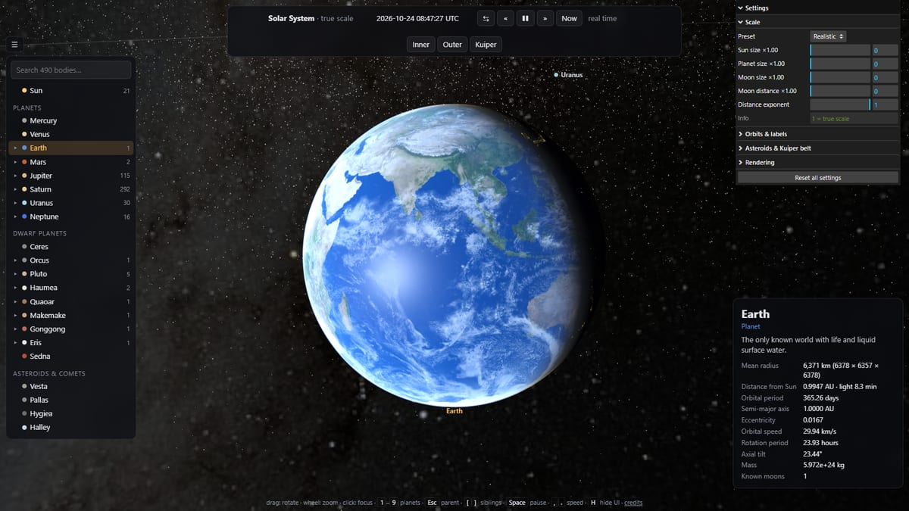
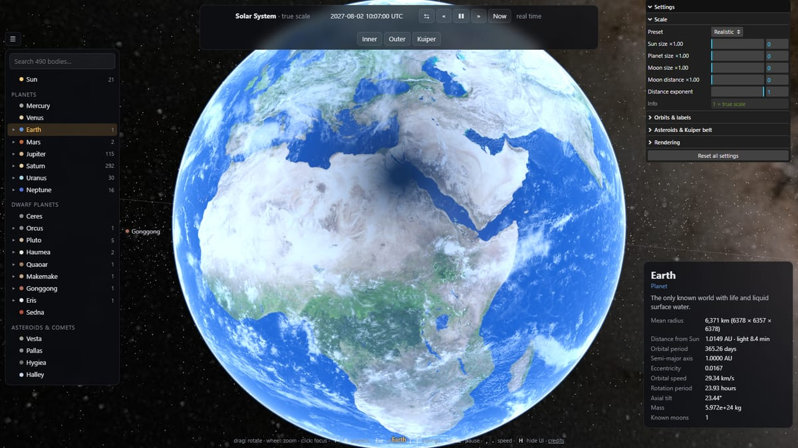
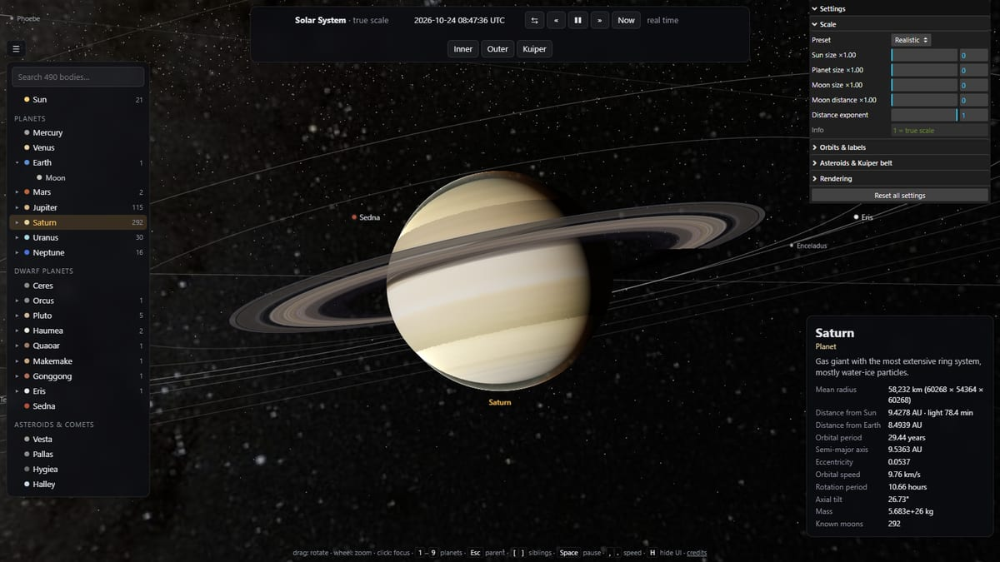
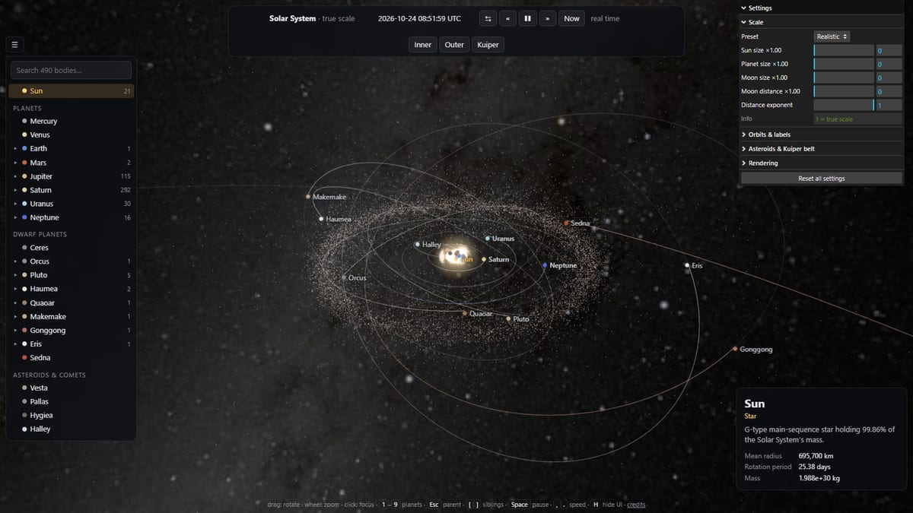

# Solar System

Interactive, true-scale simulation of the Solar System in the browser, built with three.js.

**Live demo: https://jstale.github.io/solar-system/** (deployed from `main` by GitHub Actions)

| | |
| --- | --- |
|  |  |
|  |  |

- **Sun, 8 planets, 12 dwarf planets / large asteroids / Halley's comet, 467 moons** (every moon in
  JPL's satellite tables plus the moons of Eris, Haumea, Makemake, Orcus, Quaoar and Gonggong).
- **Real positions for any date**: planets from JPL's Keplerian elements, moons from JPL mean
  elements (with nodal/apsidal precession and Laplace planes), the Moon from a truncated ELP-2000
  lunar theory (≈0.01°), dwarf planets from the JPL Small-Body Database. Eclipses happen on their
  real dates – try 2 Aug 2027 10:07 UTC (Moon's shadow over Egypt) or 3 Mar 2026 11:33 UTC (blood moon).
- **Real orientation and spin** from the IAU WGCCRE 2015 rotation models; inner moons are tidally locked.
- **Real textures** (up to 8K, streamed in when you fly close), Earth with night lights, ocean
  glint, normal map and drifting clouds that cast shadows; Venus' super-rotating cloud deck.
- **Physically motivated rendering**: eclipse shadows (penumbra computed from the Sun's disc),
  ring shadows on Saturn and Saturn's shadow on its rings, analytic atmospheres with real scale
  heights (thin blue limb on Earth, orange haze on Titan), lit/unlit ring faces.
- **Asteroid belt (with Kirkwood gaps, Hungarias, Hildas), Jupiter trojans, Kuiper belt and
  scattered disc**, ~77 000 particles propagated on the GPU; the resonant groups stay locked to
  Jupiter / Neptune.
- **Star background** from NASA's Deep Star Maps in equatorial coordinates, so constellations and
  the Milky Way are where they are in the real sky.

## Running

```bash
npm install
npm run textures   # downloads ~380 MB of source maps once (kept in .cache/), writes public/textures (≈120 MB)
npm run dev        # http://localhost:5173
```

The app still runs without textures (flat colours). Append `#Saturn` (or any body name) to the
URL to start there.

## Deployment

Every push to `main` runs `.github/workflows/deploy.yml`, which runs `npm ci` and `npm run build`
and publishes `dist/` to GitHub Pages. The generated textures are committed under
`public/textures`, so CI never downloads them from the third-party sites. The build uses relative
URLs (`base: './'` in `vite.config.js`), so `dist/` also works as-is on any other static host or
sub-path.

## Controls

| Input | Action |
| --- | --- |
| drag / wheel | orbit / zoom around the focused body |
| click a body or label | fly to it (double-click: also reset the zoom) |
| `1`–`9`, `0` | Mercury … Pluto, Sun |
| `Esc` | focus the parent body · `[` `]` previous / next sibling |
| `Space` | pause · `,` `.` slower / faster · `R` reverse · `N` now |
| `+` `-` | zoom · `O` orbits · `L` labels · `B` body list · `H` hide the UI |

Click the date to type any date (1 AD – 3000 AD; accuracy is best 1800–2050).

## Changing the scale

Everything is true scale by default. The *Scale* folder in the settings panel (and `src/settings.js`)
has independent multipliers:

| Setting | Meaning |
| --- | --- |
| `sunScale` | Sun radius |
| `planetScale` | planets, dwarf planets, asteroids, comet |
| `moonScale` | moon radii |
| `moonOrbitScale` | moon distances *above the planet's surface* – moons always stay outside an enlarged planet |
| `distanceExponent` | heliocentric distance r → 1 AU · (r / 1 AU)^p; `p < 1` compresses the outer system |

Presets: *Realistic*, *Enlarged bodies*, *Compressed system* (`PRESETS` in `src/settings.js`).
The mapping lives in `SolarSystem.helioToDisplay()` / `moonToDisplay()` (`src/scene/system.js`);
the belts apply the same exponent in their shader. Physical values (info panel, eclipses) always
use true positions.

## Project layout

```
src/
  astro/        time, reference frames, Kepler orbits, IAU rotation, lunar theory
  data/         bodies.js (Sun, planets, small bodies), moons.json (generated), moons-extra.js
  scene/        body.js (meshes per body), system.js (builds + updates everything),
                materials.js (eclipse / ring shadows, Earth shader), atmosphere.js, rings.js,
                belts.js (GPU point clouds), orbitLine.js, sky.js, glow.js, textures.js
  ui/           labels, body tree + info card, time bar, settings panel
  camera.js     follow / fly-to camera
  main.js       wiring and the render loop
tools/
  fetch-textures.mjs   downloads and resizes textures, converts the HDR star map
  build_moons.py       regenerates src/data/moons.json from JPL + Wikipedia pages
```

Units are kilometres in an ecliptic-J2000 frame (Y = ecliptic north). A logarithmic depth buffer
covers 1 m to 10¹³ km, and every custom shader works in view space so precision holds anywhere.
`window.solar` exposes the system, camera rig, clock and settings in the dev-tools console.

To refresh the moon list (new discoveries), save these pages and run the script:

```bash
curl -o elem.html https://ssd.jpl.nasa.gov/sats/elem/
curl -o phys.html https://ssd.jpl.nasa.gov/sats/phys_par/
curl -o wiki.html https://en.wikipedia.org/api/rest_v1/page/html/List_of_natural_satellites
python -I tools/build_moons.py elem.html phys.html wiki.html src/data/moons.json
```

## Credits

- Orbits: JPL Solar System Dynamics (planetary elements by E. M. Standish, satellite mean elements,
  Small-Body Database); J. Meeus, *Astronomical Algorithms* (lunar theory).
- Rotation: IAU WGCCRE 2015 report (Archinal et al. 2018).
- Planet textures: [Solar System Scope](https://www.solarsystemscope.com/textures/) (CC BY 4.0).
  The Eris, Haumea and Makemake maps are artist's impressions.
- Moon, Pluto, Ceres, Vesta maps: [Steve Albers](https://stevealbers.net/albers/sos/sos.html)
  (NASA / JPL / USGS data), Björn Jónsson (Callisto),
  [NASA 3D Resources](https://github.com/nasa/NASA-3D-Resources) (Phobos, Deimos, Umbriel).
- Stars: NASA/Goddard SVS [Deep Star Maps 2020](https://svs.gsfc.nasa.gov/4851).

Moons without spacecraft maps (most small irregular moons) use a tinted generic surface on a
procedurally lumpy shape; their sizes come from JPL or Wikipedia, or default to 1.5 km when unknown.

## License

The code is released under the [MIT License](LICENSE). The textures and source data listed under
Credits remain under their owners' terms.
